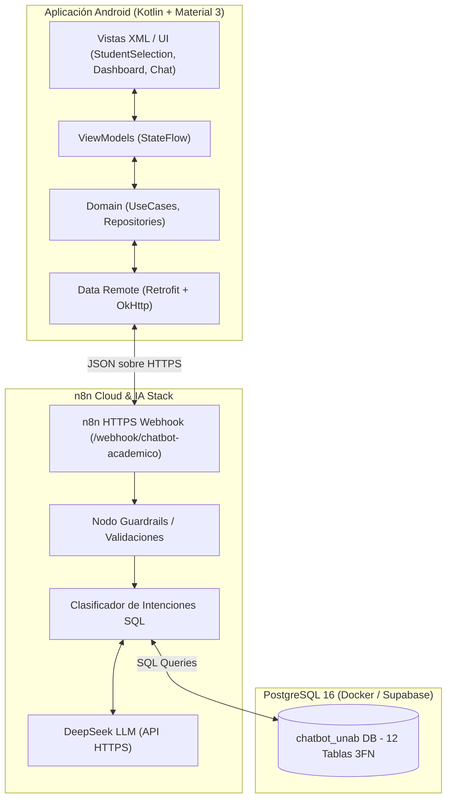

# Chatbot de Apoyo Académico - Universidad Autónoma de Bucaramanga (UNAB)

[](https://developer.android.com/)
[](https://kotlinlang.org/)
[](https://www.postgresql.org/)
[](https://n8n.io/)
[](https://deepseek.com/)

Proyecto universitario de **Ciencia de Datos** enfocado en el desarrollo de un **Chatbot de Apoyo Académico** inteligente para estudiantes de Ingeniería de Sistemas de la UNAB. 

La solución integra una aplicación móvil nativa en **Android (Kotlin)** con una arquitectura limpia (**MVVM + Clean Architecture**), un motor de base de datos relacional (**PostgreSQL**) en **Docker**, automatización mediante **n8n Cloud** y el modelo de inteligencia artificial **DeepSeek LLM**.

---

## 🏛️ Arquitectura del Sistema



---

## 🚀 Funcionalidades Principales

1. **Selección de Estudiante DEMO**:
   - Acceso inmediato simulando 3 perfiles reales de estudiantes ficticios:
     - `U00010001` - Carlos Gómez (Estudiante Regular Aprobado, Promedio 4.22).
     - `U00010002` - María Rodríguez (Estudiante con Asignaturas Repetidas y Reprobadas).
     - `U00010003` - Juan Pérez (Estudiante de Nuevo Ingreso 2026-1).

2. **Panel Académico (Dashboard)**:
   - Resumen del plan activo del estudiante (`PENSUM-DEMO-2024`).
   - Accesos directos a preguntas rápidas sobre el avance académico.

3. **Chatbot Académico Interactivo**:
   - Interfaz conversacional en tiempo real con burbujas diferenciadas de mensaje.
   - Consultas académicas soportadas:
     - **Materias Aprobadas**: Muestra asignaturas superadas, notas y periodos.
     - **Materias Reprobadas**: Identifica pérdidas y sugiere repetición.
     - **Materias Pendientes**: Lista asignaturas por cursar organizadas por semestre.
     - **Materias en Curso**: Muestra materias matriculadas en el semestre vigente.
     - **Promedio Acumulado (GPA)**: Calcula dinámicamente la nota promedio.
     - **Créditos Aprobados y Faltantes**: Calcula avance y % completado.
     - **Prerrequisitos Pendientes**: Mapea asignaturas requeridas previamente.
     - **Proyección de Matrícula**: Lista materias disponibles según prerrequisitos cumplidos.

4. **Guardrails de Seguridad**:
   - Bloqueo automático de lenguaje ofensivo, spam y consultas largas (> 500 caracteres).
   - Prevención estricta de inyección de código SQL y solicitud de credenciales/secretos.

5. **Memoria Persistente de Chat**:
   - Registro de conversaciones y mensajes cronológicos por estudiante en PostgreSQL (`conversaciones` y `mensajes`).

---

## 🛠️ Tecnologías Utilizadas

- **Móvil**: Kotlin `2.2.10`, Android SDK 37 (API 26+ Oreo), Material Design 3, Retrofit `2.11.0`, Gson, OkHttp `4.12.0`, Coroutines & StateFlow.
- **Base de Datos**: PostgreSQL 16 Alpine, 12 tablas en 3FN, Triggers PL/pgSQL para protección de periodos cerrados.
- **Infraestructura**: Docker Desktop, Docker Compose, n8n Orchestration.
- **IA**: DeepSeek LLM (API Chat Completions).

---

## 📋 Estructura de la Base de Datos (12 Tablas 3FN)

1. `programas`: Registro de carreras (Ingeniería de Sistemas DEMO).
2. `estudiantes`: Expediente ficticio de estudiantes.
3. `planes_estudio`: Pensa curriculares (`PENSUM-DEMO-2020`, `PENSUM-DEMO-2024`).
4. `estudiante_plan_estudio`: Asignación activa y cambios de pensum por estudiante.
5. `materias`: Catálogo de asignaturas y créditos.
6. `plan_materias`: Ubicación semestral de asignaturas.
7. `prerrequisitos`: Matriz N:M de requisitos y correquisitos.
8. `politicas_academicas`: Parámetros configurables de notas (nota aprobación: 3.00).
9. `periodos_academicos`: Semestres lectivos (2024-1 a 2026-1) con marca de cierre `cerrado`.
10. `historial_academico`: Registro de intentos, notas (0.00-5.00) y estado (`APROBADA`, `REPROBADA`, `EN_CURSO`, `CANCELADA`).
11. `conversaciones`: Sesiones de chat por estudiante.
12. `mensajes`: Historial de mensajes (remitente, contenido, timestamp).

---

## ⚙️ Guía Rápida de Instalación y Ejecución

### 1. Clonar el Repositorio
```bash
git clone https://github.com/JaimeLuiss/Chatbot.git
cd Chatbot
```

### 2. Iniciar la Infraestructura Docker (PostgreSQL 16 + n8n)
```bash
docker compose up -d
```

### 3. Ejecutar los Scripts SQL
```powershell
Get-Content database/01_crear_tablas.sql -Raw | docker exec -i chatbot_db psql -U chatbot_admin -d chatbot_unab
Get-Content database/02_datos_sinteticos.sql -Raw | docker exec -i chatbot_db psql -U chatbot_admin -d chatbot_unab
Get-Content database/03_consultas_academicas.sql -Raw | docker exec -i chatbot_db psql -U chatbot_admin -d chatbot_unab
Get-Content database/04_pruebas_integridad.sql -Raw | docker exec -i chatbot_db psql -U chatbot_admin -d chatbot_unab
Get-Content database/05_memoria_chat.sql -Raw | docker exec -i chatbot_db psql -U chatbot_admin -d chatbot_unab
```

### 4. Configurar la URL del Webhook en Android
Editar la clase `NetworkConfig.kt` (`app/src/main/java/com/example/chatbot/core/network/NetworkConfig.kt`):
```kotlin
object NetworkConfig {
    const val N8N_WEBHOOK_URL = "https://tu-instancia-n8n.cloud/webhook/chatbot-academico"
}
```

### 5. Compilar y Ejecutar en Android Studio
- Abrir el proyecto en Android Studio (Ladybug / 2024+).
- Ejecutar en un emulador Android (API 26+) o dispositivo físico.

---

## 📚 Documentación Detallada

- 📖 [Guía Completa de Instalación](docs/instalacion/guia_instalacion_completa.md)
- 🎭 [Guion de Demostración Académica](docs/presentacion/guion_demostracion.md)
- 📊 [Diseño de Base de Datos y Modelo ER](docs/base_datos/diseno_modelo_entidad_relacion.md)
- 🏗️ [Documentación de Arquitectura Android MVVM](docs/arquitectura/arquitectura_aplicacion.md)
- 🐳 [Despliegue de Infraestructura Local con Docker](docs/infraestructura/despliegue_local.md)
- ✅ [Lista de Comprobación de Entrega Final](docs/entrega/checklist_final.md)

---

## 🧑‍💻 Autoría y Licencia

- **Autor**: JaimeLuiss (`jrueda793@unab.edu.co`)
- **Institución**: Universidad Autónoma de Bucaramanga (UNAB)
- **Programa**: Ingeniería de Sistemas / Ciencia de Datos
