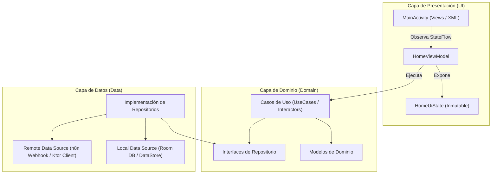

# Documentación de Arquitectura - Chatbot Académico UNAB

## 1. Patrón Arquitectónico MVVM (Model-View-ViewModel)
El patrón **MVVM** desacopla la lógica de interfaz de usuario de la lógica de presentación y de negocio:
- **View (Vistas)**: `MainActivity` y layouts XML. Su única responsabilidad es renderizar los datos del estado inmutable (`HomeUiState`) y capturar eventos del usuario.
- **ViewModel**: `HomeViewModel`. Mantiene y expone el estado de la pantalla mediante `StateFlow`. No conserva referencias a objetos de la Activity ni al `Context` de Android para evitar fugas de memoria y facilitar pruebas unitarias aisladas.
- **Model**: Capa de datos y modelos de dominio que proveen la información requerida por el ViewModel.

## 2. Clean Architecture
El proyecto implementa la filosofía de **Clean Architecture** estructurada en capas independientes con la regla de dependencia unidireccional (las capas internas no conocen detalles de las externas):



## 3. Responsabilidad de cada Capa y Paquete

```
com.example.chatbot/
├── core/
│   ├── common/       # Utilidades globales y constantes compartidas.
│   └── result/       # Clases wrapper de resultado (Result.Success, Result.Error).
├── data/
│   ├── local/        # Data Sources locales (Base de datos Room, DataStore).
│   ├── remote/       # Data Sources remotos (Clientes HTTP, Webhooks de n8n).
│   └── repository/   # Implementaciones concretas de las interfaces de repositorio.
├── domain/
│   ├── model/        # Entidades y modelos de negocio puros.
│   ├── repository/   # Contratos / Interfaces de repositorios (desacopladas del origen de datos).
│   └── usecase/      # Reglas de negocio y casos de uso específicos.
└── ui/
    ├── home/         # Pantalla principal (MainActivity, HomeViewModel, HomeUiState).
    ├── academic/     # Módulo de consulta de materias, notas e historial académico.
    ├── chat/         # Módulo de conversación con el Chatbot e historial de chat.
    ├── history/      # Historial académico y registros.
    └── components/   # Componentes visuales y reutilizables de UI.
```

## 4. Flujo de Información entre Capas
1. El usuario interactúa con la **View** (ej: presiona un botón o consulta una nota).
2. La **View** notifica el evento al **ViewModel**.
3. El **ViewModel** invoca el **UseCase** correspondiente en la capa de Dominio.
4. El **UseCase** ejecuta la lógica de negocio consultando la interfaz del **Repository**.
5. La implementación del **Repository** (en la capa Data) consulta el **Data Source** (local o remoto vía n8n/PostgreSQL).
6. El resultado fluye de regreso convirtiéndose en un modelo de dominio y se emite como un estado inmutable (`StateFlow`) desde el **ViewModel**.
7. La **View** reacciona automáticamente al cambio de estado utilizando `repeatOnLifecycle` y actualiza la pantalla.

## 5. Funcionamiento de ViewModel y StateFlow
- `HomeViewModel` hereda de `androidx.lifecycle.ViewModel`, sobreviviendo a los cambios de configuración del dispositivo (como rotaciones de pantalla).
- Utiliza una propiedad privada mutable `_uiState = MutableStateFlow(...)` y expone una propiedad pública inmutable `val uiState: StateFlow<HomeUiState> = _uiState.asStateFlow()`.
- `MainActivity` se suscribe al flujo de manera segura frente al ciclo de vida con `lifecycleScope.launch` y `repeatOnLifecycle(Lifecycle.State.STARTED)`.

## 6. Integración Futura del Stack Tecnológico
- **PostgreSQL**: Se conectará en la capa `data/remote` o mediante un servidor intermedio.
- **n8n Workflow**: Recibirá las peticiones HTTP/REST emitidas por el `RemoteDataSource` (`data/remote`), procesará el flujo de IA con Guardrails y retornará las respuestas estructuradas al repositorio.
- **API de IA**: El modelo LLM será orquestado dentro de los nodos de n8n, protegiendo llaves de acceso y aplicando modulación académica antes de entregar la información al móvil.

## 7. Justificación de Decisiones Técnicas
- **Vistas XML y Material 3**: Garantizan estabilidad, soporte total en herramientas de inspección y respuesta fluida en dispositivos móviles con Android 8.0 (API 26) o superior.
- **StateFlow + repeatOnLifecycle**: Evita fugas de memoria y suspensión de emisiones cuando la actividad está en segundo plano.
- **Monomódulo inicial**: Facilita una transición rápida al desarrollo progresivo manteniendo un orden riguroso de paquetes sin sobrecargar la configuración Gradle.
