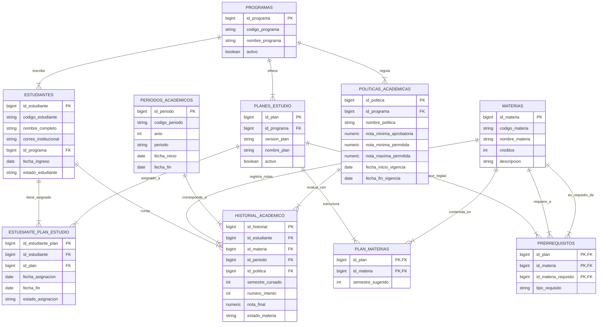

# Diseño Técnico y Conceptual de la Base de Datos Relacional - Chatbot Académico UNAB (Modelo Refinado - 10 Tablas)

## 1. Descripción General

El presente documento especifica el modelo relacional técnico y conceptual refinado de la base de datos para el **Chatbot de Apoyo Académico para estudiantes de Ingeniería de Sistemas de la Universidad Autónoma de Bucaramanga (UNAB)**.

El motor de base de datos seleccionado es **PostgreSQL** (compatible con **Supabase**). El modelo atiende la necesidad de registrar la trayectoria académica completa de los estudiantes, soportando:
- Múltiples versiones de planes de estudio (pensa) y transiciones/cambios de plan por estudiante.
- Políticas académicas de aprobación configurables y desacopladas de la aplicación Android.
- Distinción técnica entre **Prerrequisitos** (asignaturas que se deben aprobar previamente) y **Correquisitos** (asignaturas que se deben cursar de forma simultánea o previa).
- Registro detallado de múltiples intentos de una misma materia en diferentes periodos lectivos.
- Consultas ágiles y precisas para la capa de orquestación en **n8n** y consumo móvil.

---

## 2. Decisiones de Diseño y Arquitectura de Datos

### 2.1 Asignación y Transición de Planes de Estudio (`estudiante_plan_estudio`)
Inicialmente, se contempló vincular directamente al estudiante con su programa académico. Sin embargo, un estudiante ingresa bajo una versión específica del plan de estudios (ej. *Pensum 2020*) y con el tiempo la facultad puede actualizar la malla curricular (*Pensum 2024*). 

Para resolver esto sin alterar el historial pasado, se creó la tabla puente **`estudiante_plan_estudio`**:
- Mantiene la historia de qué plan de estudios tuvo o tiene asignado cada estudiante.
- Registra la `fecha_asignacion`, `fecha_fin` y el `estado_asignacion` (`'ACTIVO'`, `'INACTIVO'`).
- Permite que las consultas de materias pendientes y avance académico se evalúen contra la versión del pensum que el estudiante **realmente tiene activa**.

### 2.2 Configuración Dinámica de Políticas Académicas (`politicas_academicas`)
Para evitar "quemar" la nota mínima de aprobación en el código fuente de la app Android o en vistas SQL estáticas, se creó la entidad **`politicas_academicas`**:
- Permite configurar parámetros clave: `nota_minima_aprobatoria` (ej: `3.00`), `nota_minima_permitida` (`0.00`), `nota_maxima_permitida` (`5.00`), y el rango de vigencia (`fecha_inicio_vigencia`, `fecha_fin_vigencia`).
- **Preservación Histórica**: Cuando el periodo académico cierra, la nota y el estado final (`'APROBADA'`, `'REPROBADA'`) registrados en `historial_academico` quedan congelados como hechos históricos inmutables. Si la universidad modifica la nota de aprobación en el futuro, no se alteran retroactivamente los estados de semestres pasados.

### 2.3 Clasificación de Requisitos (`prerrequisitos`)
Se mejoró la entidad `prerrequisitos` añadiendo la columna `tipo_requisito`:
- `'PRERREQUISITO'`: La asignatura requisito debe estar **aprobada** (`estado_materia = 'APROBADA'`) en un periodo académico **anterior** al periodo en que se desea inscribir la materia.
- `'CORREQUISITO'`: La asignatura requisito se puede cursar **simultáneamente** en el mismo periodo o haber sido aprobada con anterioridad.
- Los requisitos están acotados a cada versión del plan de estudio (`id_plan`), de forma que actualizar los requisitos en el *Pensum 2024* no distorsiona el flujo de estudiantes matriculados en el *Pensum 2020*.

---

## 3. Diccionario de Datos Completo (10 Tablas)

### 3.1 Tabla `programas`
| Campo | Tipo de Dato | PK/FK | Nulo | Descripción / Restricción |
| :--- | :--- | :--- | :--- | :--- |
| `id_programa` | `BIGINT` | PK | No | Identificador único (`GENERATED ALWAYS AS IDENTITY`). |
| `codigo_programa` | `VARCHAR(20)` | - | No | Código oficial del programa (ej: `'ING-SIST'`). `UNIQUE`. |
| `nombre_programa` | `VARCHAR(150)` | - | No | Nombre completo del programa académico. |
| `activo` | `BOOLEAN` | - | No | Estado operativo. `DEFAULT TRUE`. |

### 3.2 Tabla `estudiantes`
| Campo | Tipo de Dato | PK/FK | Nulo | Descripción / Restricción |
| :--- | :--- | :--- | :--- | :--- |
| `id_estudiante` | `BIGINT` | PK | No | Identificador único autoincremental. |
| `codigo_estudiante` | `VARCHAR(20)` | - | No | Código académico ficticio (ej: `'U00012345'`). `UNIQUE`. |
| `nombre_completo` | `VARCHAR(200)` | - | No | Nombres y apellidos completos. |
| `correo_institucional`| `VARCHAR(150)` | - | No | Correo electrónico ficticio. `UNIQUE`. |
| `id_programa` | `BIGINT` | FK | No | Referencia a `programas(id_programa)`. |
| `fecha_ingreso` | `DATE` | - | No | Fecha de admisión/ingreso. |
| `estado_estudiante` | `VARCHAR(30)` | - | No | Estado (`'ACTIVO'`, `'INACTIVO'`, `'GRADUADO'`). |

### 3.3 Tabla `planes_estudio`
| Campo | Tipo de Dato | PK/FK | Nulo | Descripción / Restricción |
| :--- | :--- | :--- | :--- | :--- |
| `id_plan` | `BIGINT` | PK | No | Identificador único autoincremental. |
| `id_programa` | `BIGINT` | FK | No | Referencia a `programas(id_programa)`. |
| `version_plan` | `VARCHAR(20)` | - | No | Versión del pensum (ej: `'PENSUM-2024'`). |
| `nombre_plan` | `VARCHAR(100)` | - | No | Nombre descriptivo del plan. |
| `activo` | `BOOLEAN` | - | No | Indica si el plan se ofrece actualmente. `DEFAULT TRUE`. |

### 3.4 Tabla `estudiante_plan_estudio` (NUEVA)
| Campo | Tipo de Dato | PK/FK | Nulo | Descripción / Restricción |
| :--- | :--- | :--- | :--- | :--- |
| `id_estudiante_plan`| `BIGINT` | PK | No | Identificador único autoincremental. |
| `id_estudiante` | `BIGINT` | FK | No | Referencia a `estudiantes(id_estudiante)`. |
| `id_plan` | `BIGINT` | FK | No | Referencia a `planes_estudio(id_plan)`. |
| `fecha_asignacion` | `DATE` | - | No | Fecha en la que se le asignó esta versión del plan. |
| `fecha_fin` | `DATE` | - | Sí | Fecha en que finalizó la asignación (nulo si está vigente). |
| `estado_asignacion` | `VARCHAR(20)` | - | No | Estado (`'ACTIVO'`, `'INACTIVO'`). `DEFAULT 'ACTIVO'`. |

*Restricción*: `CHECK (fecha_fin IS NULL OR fecha_fin >= fecha_asignacion)`.

### 3.5 Tabla `materias`
| Campo | Tipo de Dato | PK/FK | Nulo | Descripción / Restricción |
| :--- | :--- | :--- | :--- | :--- |
| `id_materia` | `BIGINT` | PK | No | Identificador único autoincremental. |
| `codigo_materia` | `VARCHAR(20)` | - | No | Código oficial (ej: `'SIST-101'`). `UNIQUE`. |
| `nombre_materia` | `VARCHAR(150)` | - | No | Nombre completo de la asignatura. |
| `creditos` | `INTEGER` | - | No | Créditos académicos. `CHECK (creditos > 0)`. |
| `descripcion` | `TEXT` | - | Sí | Descripción del contenido temático. |

### 3.6 Tabla `plan_materias`
| Campo | Tipo de Dato | PK/FK | Nulo | Descripción / Restricción |
| :--- | :--- | :--- | :--- | :--- |
| `id_plan` | `BIGINT` | PK, FK | No | Referencia a `planes_estudio(id_plan)`. |
| `id_materia` | `BIGINT` | PK, FK | No | Referencia a `materias(id_materia)`. |
| `semestre_sugerido` | `INTEGER` | - | No | Ubicación en la malla (1 a 10). `CHECK (semestre_sugerido >= 1)`. |

### 3.7 Tabla `prerrequisitos`
| Campo | Tipo de Dato | PK/FK | Nulo | Descripción / Restricción |
| :--- | :--- | :--- | :--- | :--- |
| `id_plan` | `BIGINT` | PK, FK | No | Referencia a `planes_estudio(id_plan)`. |
| `id_materia` | `BIGINT` | PK, FK | No | Asignatura destino. |
| `id_materia_requisito` | `BIGINT` | PK, FK | No | Asignatura exigida como requisito. |
| `tipo_requisito` | `VARCHAR(20)` | - | No | Clasificación (`'PRERREQUISITO'`, `'CORREQUISITO'`). |

*Restricción*: `CHECK (id_materia <> id_materia_requisito)`.

### 3.8 Tabla `politicas_academicas` (NUEVA)
| Campo | Tipo de Dato | PK/FK | Nulo | Descripción / Restricción |
| :--- | :--- | :--- | :--- | :--- |
| `id_politica` | `BIGINT` | PK | No | Identificador único autoincremental. |
| `id_programa` | `BIGINT` | FK | Sí | Referencia opcional a `programas(id_programa)`. Nulo si es institucional. |
| `nombre_politica` | `VARCHAR(100)` | - | No | Nombre descriptivo de la regla (ej: `'Reglamento Pregrado UNAB'`). |
| `nota_minima_aprobatoria`| `NUMERIC(3,2)`| - | No | Nota mínima para aprobar (ej: `3.00`). |
| `nota_minima_permitida`| `NUMERIC(3,2)`| - | No | Calificación mínima alcanzable (ej: `0.00`). |
| `nota_maxima_permitida`| `NUMERIC(3,2)`| - | No | Calificación máxima alcanzable (ej: `5.00`). |
| `fecha_inicio_vigencia`| `DATE` | - | No | Fecha de entrada en vigor de la política. |
| `fecha_fin_vigencia` | `DATE` | - | Sí | Fecha de retiro (nulo si está vigente). |

*Restricción*: `CHECK (nota_minima_aprobatoria >= nota_minima_permitida AND nota_minima_aprobatoria <= nota_maxima_permitida)`.

### 3.9 Tabla `periodos_academicos`
| Campo | Tipo de Dato | PK/FK | Nulo | Descripción / Restricción |
| :--- | :--- | :--- | :--- | :--- |
| `id_periodo` | `BIGINT` | PK | No | Identificador único. |
| `codigo_periodo` | `VARCHAR(20)` | - | No | Código legible (ej: `'2026-1'`). `UNIQUE`. |
| `anio` | `INTEGER` | - | No | Año lectivo (ej: 2026). |
| `periodo` | `VARCHAR(10)` | - | No | Semestre (`'1'`, `'2'`, `'VAC'`). |
| `fecha_inicio` | `DATE` | - | No | Fecha de inicio. |
| `fecha_fin` | `DATE` | - | No | Fecha de finalización. `CHECK (fecha_fin >= fecha_inicio)`. |

### 3.10 Tabla `historial_academico`
| Campo | Tipo de Dato | PK/FK | Nulo | Descripción / Restricción |
| :--- | :--- | :--- | :--- | :--- |
| `id_historial` | `BIGINT` | PK | No | Identificador único del intento/registro. |
| `id_estudiante` | `BIGINT` | FK | No | Referencia a `estudiantes(id_estudiante)`. |
| `id_materia` | `BIGINT` | FK | No | Referencia a `materias(id_materia)`. |
| `id_periodo` | `BIGINT` | FK | No | Referencia a `periodos_academicos(id_periodo)`. |
| `id_politica` | `BIGINT` | FK | Sí | Referencia a la `politicas_academicas` aplicada en este periodo. |
| `semestre_cursado`| `INTEGER` | - | No | Semestre relativo en que realmente la cursó. |
| `numero_intento` | `INTEGER` | - | No | Número de veces cursada (1, 2, 3...). `CHECK (numero_intento >= 1)`. |
| `nota_final` | `NUMERIC(3,2)`| - | Sí | Nota definitiva (0.00 a 5.00). Nulo si está `EN_CURSO`. |
| `estado_materia` | `VARCHAR(20)` | - | No | Estado (`'APROBADA'`, `'REPROBADA'`, `'EN_CURSO'`, `'CANCELADA'`). |

*Restricción UNIQUE*: `UNIQUE (id_estudiante, id_materia, id_periodo, numero_intento)`.

---

## 4. Relaciones y Cardinalidades

```
programas (1) <-------- (N) estudiantes
programas (1) <-------- (N) planes_estudio
programas (1) <-------- (N) politicas_academicas
estudiantes (1) <------ (N) estudiante_plan_estudio (N) ----> (1) planes_estudio
planes_estudio (1) <---- (N) plan_materias (N) -----------> (1) materias
planes_estudio (1) <---- (N) prerrequisitos
materias (1) <---------- (N) prerrequisitos (destino)
materias (1) <---------- (N) prerrequisitos (requisito)
estudiantes (1) <------- (N) historial_academico
materias (1) <---------- (N) historial_academico
periodos_academicos (1) < (N) historial_academico
politicas_academicas (1)< (N) historial_academico
```

---

## 5. Diagrama Entidad-Relación (Mermaid - 10 Tablas)



---

## 6. Revisión de Normalización (1FN, 2FN y 3FN)

1. **Primera Forma Normal (1FN)**:
   - Todos los dominios de atributos son escalares y atómicos. No existen listas delimitadas por comas ni arreglos empotrados en celdas.
2. **Segunda Forma Normal (2FN)**:
   - Para las tablas con PK compuesta (`plan_materias`, `prerrequisitos`), los atributos no clave (`semestre_sugerido`, `tipo_requisito`) dependen de la **clave primaria completa**, sin dependencias parciales.
3. **Tercera Forma Normal (3FN)**:
   - No existen dependencias transitivas. Los valores calculables (promedio ponderado, créditos acumulados, estado activo del plan asignado) no se almacenan como columnas en `estudiantes`, sino que se consultan dinámicamente en SQL.

---

## 7. Consultas Académicas para el Chatbot (Integrando Políticas y Plan Activo)

### 7.1 Identificar las materias que un estudiante puede cursar según sus prerrequisitos y su plan activo
```sql
WITH plan_activo AS (
    SELECT id_plan 
    FROM estudiante_plan_estudio 
    WHERE id_estudiante = :idEstudiante AND estado_asignacion = 'ACTIVO'
    LIMIT 1
),
materias_aprobadas AS (
    SELECT DISTINCT id_materia
    FROM historial_academico
    WHERE id_estudiante = :idEstudiante AND estado_materia = 'APROBADA'
),
materias_pendientes AS (
    SELECT pm.id_materia, pm.semestre_sugerido
    FROM plan_materias pm
    JOIN plan_activo pa ON pm.id_plan = pa.id_plan
    WHERE pm.id_materia NOT IN (SELECT id_materia FROM materias_aprobadas)
)
SELECT m.codigo_materia, m.nombre_materia, mp.semestre_sugerido, m.creditos
FROM materias_pendientes mp
JOIN materias m ON mp.id_materia = m.id_materia
WHERE NOT EXISTS (
    SELECT 1 
    FROM prerrequisitos pr
    JOIN plan_activo pa ON pr.id_plan = pa.id_plan
    WHERE pr.id_materia = mp.id_materia
      AND pr.tipo_requisito = 'PRERREQUISITO'
      AND pr.id_materia_requisito NOT IN (SELECT id_materia FROM materias_aprobadas)
);
```

### 7.2 Consultar el promedio acumulado real utilizando las notas históricas
```sql
SELECT 
    e.codigo_estudiante,
    e.nombre_completo,
    COUNT(DISTINCT h.id_materia) FILTER (WHERE h.estado_materia = 'APROBADA') AS materias_aprobadas,
    SUM(m.creditos) FILTER (WHERE h.estado_materia = 'APROBADA') AS creditos_aprobados,
    ROUND(SUM(h.nota_final * m.creditos) / NULLIF(SUM(m.creditos), 0), 2) AS promedio_acumulado
FROM estudiantes e
JOIN historial_academico h ON e.id_estudiante = h.id_estudiante
JOIN materias m ON h.id_materia = m.id_materia
WHERE e.id_estudiante = :idEstudiante
  AND h.nota_final IS NOT NULL
GROUP BY e.id_estudiante, e.codigo_estudiante, e.nombre_completo;
```

---

## 8. Información Oficial Pendiente por Conseguir

1. **Malla Curricular Oficial de Ingeniería de Sistemas UNAB** (Nombres exactos de asignaturas, códigos y distribución de créditos).
2. **Matriz Oficial de Prerrequisitos y Correquisitos** definida por la facultad.
3. **Reglamento Estudiantil UNAB** (Nota mínima oficial de aprobación para pregrado y políticas sobre pérdida de cupo/prueba académica).

> [!NOTE]
> *Todas las materias, nombres de estudiante y periodos usados en ejemplos son estrictamente ficticios y con propósito exclusivo de demostración del modelo de base de datos.*
